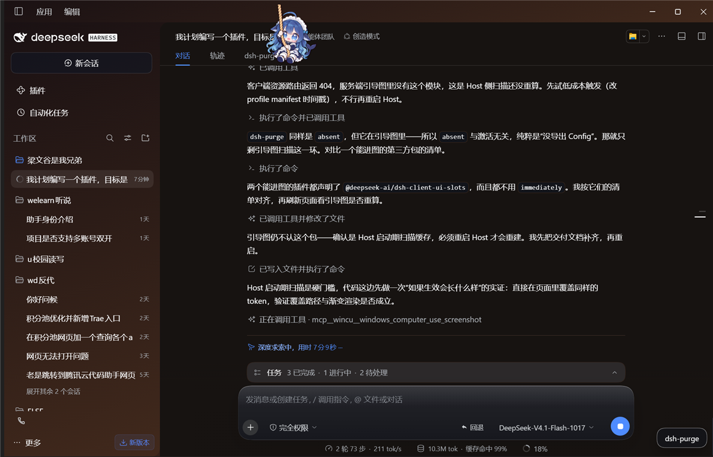
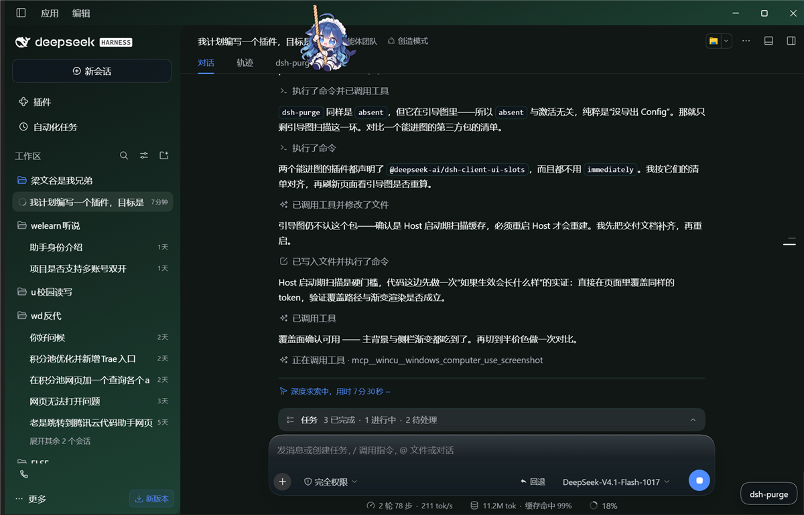

# dsh-peak-tint · 峰谷染色

把 DeepSeek API 的**原价 / 半价时段**，直接画进 DeepSeek Harness 的界面里。
不再是一个告诉你"现在几点贵"的小挂件——**界面本身的颜色就是计费状态**。

- 🟠 原价时段：侧栏、描边（可选整块背景）转暖色
- 🟢 半价时段：转冷绿
- 时段表、配色、渐变方向、不透明度**全部可改，即时生效，无需重启**

| 原价时段 | 半价时段 |
| --- | --- |
|  |  |

> 非官方项目，与 DeepSeek 无隶属或背书关系，仅使用 DSH 公开的插件协议。
> 计费规则以 [DeepSeek 官方价格页](https://api-docs.deepseek.com/zh-cn/quick_start/pricing/) 为准。

---

## 计费口径

官方现行规则（核对于 2026-10-23）：

| 时段 | 北京时间 | 价格 |
| --- | --- | --- |
| **原价 / 高峰** | 周一至周五（不含法定节假日）**09:00–12:00、14:00–18:00** | 标准价 |
| **半价 / 空闲** | 其余全部时间，含周末与法定节假日全天 | 高峰价的 **50%** |

元 / 百万 tokens（空闲 → 高峰）：

| 模型 | 缓存命中输入 | 未命中输入 | 输出 |
| --- | --- | --- | --- |
| `deepseek-flash` | 0.02 → 0.04 | 1 → 2 | 4 → 8 |
| `deepseek-v4-pro` | 0.15 → 0.30 | 4.5 → 9 | 13.5 → 27 |

⚠️ 2025 年那套「00:30–08:30 错峰优惠」**已于 2025-09-05 取消**，网上大量教程仍在沿用；本插件不采用它。

**本插件不识别法定节假日**（按你的要求）：节假日会被当成普通工作日判断。
若某天是法定节假日，可在设置里临时把该天的时段删掉，或改用一个不含该星期的时段表。

---

## 特性

### 1. 时段完全可编辑

设置 → 插件 → **峰谷染色**：

- 每个"原价窗口" = 一组星期 + 起止时间，可增删
- 支持跨夜（如 `22:00 → 06:00`）
- 时间按**北京时间**解释，与你系统时区无关（出国也不会算错）
- 命中任一窗口即原价，其余全部半价

### 2. 颜色可选、渐变可调

- 6 套内置配色：琥珀 / 玫瑰 / 青碧 / 紫罗兰 / 翠绿 / 石墨
- 四支取色器：原价浅色、原价深色、半价浅色、半价深色
- 渐变角度 0–360°、渐变强度 0–100%
- **不透明度 15–100%**：低于 100% 时颜色以半透明叠加
- **壁纸兼容四档**：`自动`（检测到玻璃/壁纸插件就降级）/ `淡色 12%` / `只留胶囊`（完全不染背景）/ `不适配`
- "背景也用渐变"开关：开启后主对话背景也参与渐变（侧栏渐变始终可用）

> ⚠️ 在 Windows 布局里 `--dsw-specific-sidebar-fill` **同时是侧栏和整个窗口 frame 的背景**。装了 wallpaper-engine 这类让窗口透明的插件时，往这个 token 里灌实色等于给整窗蒙一层色。所以检测到壁纸时会自动降到 12%；嫌有颜色就选「只留胶囊」，插件只剩输入框左侧那颗胶囊在工作，背景一个像素都不动。

### 3. 三档覆盖范围

| 档位 | 覆盖的 token | 观感 |
| --- | --- | --- |
| 贴边（默认） | `--dsw-specific-sidebar-fill`、`--dsw-alias-border-l1` | 只有侧栏与分隔线带色 |
| 全屏 | 再加 `--dsw-alias-bg-base`、`--dsw-alias-bg-layer-1` | 整个主背景换氛围色 |
| 关闭 | 不覆盖任何 token | 只留胶囊文字 |

点击输入框左侧的胶囊即可在「贴边 → 全屏 → 关闭」之间循环切换。

### 4. 不干扰其他插件，冲突时明确告知

染色通过 `ctx.theme.overrideTokens()` 叠加**我们自己的那一层**实现：

- 不写全局样式表、不改 DOM、不 dispose 别人的层
- 卸载即还原，宿主主题文件完全不动
- 其他插件（或第三方皮肤）后注册的层会盖住我们，这是设计使然——此时插件会**实测**当前生效的 token 值，与自己的期望值比对：
  - 一致 → 设置页显示「染色生效」
  - 不一致 → 显示「被他层覆盖」并给出提示，胶囊上出现 `!`，点一下即可重新置顶
  - token 不存在 → 显示「token 未找到」（Harness 升级改名时会这样，而不是静默失效）
  - 主题服务缺失 → 显示「主题服务缺失」

---

## 安装

### 方式一：GitHub 仓库 / Release tarball

仓库：<https://github.com/wyp809/dsh-peak-tint>

```bash
# 源码安装
dsh plugin --profile <profile> add https://github.com/wyp809/dsh-peak-tint

# 或用预构建 tarball（免构建，几秒装完）
dsh plugin --profile <profile> add https://github.com/wyp809/dsh-peak-tint/releases/download/v0.1.0/dsh-peak-tint-0.1.0.tgz
```

### 方式二：本地目录 / 本地 tarball

```bash
dsh plugin --profile <profile> add <本目录的绝对路径>
```

或用本仓库打包后的 `.tgz`：

```bash
dsh plugin --profile <profile> add ./dsh-peak-tint-0.1.0.tgz
```

### 方式三：npm（npm 包发布后可用）

```bash
npm install -g dsh-peak-tint
dsh plugin --profile <profile> add dsh-peak-tint
```

> npm 上架需单独走一次 `npm publish`，目前以 GitHub 仓库 / Release 为准。

### 方式四：设置界面

设置 → 插件 → 粘贴本仓库 URL 或 `.tgz` 绝对路径。

### 安装后

**重启 Host，然后刷新页面。** 客户端 bundle 在 Host 启动期扫描进入引导图；只刷新页面不够。

---

## 配置存储

- 配置存在浏览器 `localStorage` 的 `dsh-peak-tint/config@1`
- 设置页底部提供 JSON 导出 / 导入，方便备份或团队分发
- 清空该键即恢复默认

---

## 兼容性

- 目标：DeepSeek Harness `0.2.x`（在 `0.2.1-rc.2` 系上开发）
- 客户端半边的依赖：`ctx.theme.overrideTokens`、`ctx.slots`；cordis `inject: ['slots', 'theme']`
- **不依赖** `ctx.timer`、`ctx.locale`、`React.Fragment`：定时器缺失时退回 `window.setTimeout`，渲染全程不用 Fragment
- 每个 slot 视图都包了一层 error boundary：视图渲染失败只会让本插件的胶囊/设置页消失，不影响输入框与设置面板
- Host 半边不注册任何服务或工具，`index.js` 只导出空 `apply`
- 若 Harness 改了 token 名，染色会降级为「token 未找到」而不是崩溃

## 自测

```bash
node test/smoke.mjs
```

用桩 React / DOM / cordis 跑真实的 `client.js`：验证 `apply` 不抛错、token 值都是合法 CSS 颜色、两个 slot 都注册、视图都能渲染出宿主元素、清理函数不抛。**这一项通过才说明插件不会把你的输入框弄坏。**


---

## 已知限制

- 不读账户余额、不算花费金额、不估算节省
- 不识别法定节假日
- 背景渐变在「全屏」+「背景也用渐变」时，若其他插件对 `--dsw-alias-bg-base` 做 `color-mix()`，该处样式可能失效（纯色模式无此问题）
- 与第三方主题皮肤同时使用时，皮肤层若更晚注册会盖住本插件；点胶囊可重新置顶
- **壁纸类插件（wallpaper-engine 等）**：自动检测 `--we-glass-alpha` / `body[data-we-*]`，命中后窗口 frame 只留 12% 色相、主内容区完全不覆盖；想要零影响就切「只留胶囊」。

## 许可证

MIT
